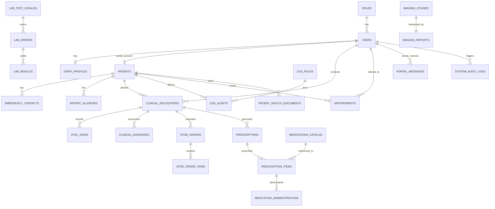

# CareConnect EHR - Entity Relationship (ER) Summary & Architecture

## System Overview
**Project**: P03 | CareConnect: Connecting Patients and Providers  
**Domain**: Healthcare & Pharma  
**Technology Stack**: Python, Django, React, MySQL 8.0  
**Database**: Normalized Relational Schema (3NF)

---

## Entity Relationships (Summary)

### 1. User Management & Access Control (Module 9)
* **`roles` (1) ────< (M) `users`**: One role has many users (Admin, Doctor, Patient, Nurse, Lab Tech). Foreign Key: `users.role_id -> roles.id`.
* **`users` (1) ──── (1) `staff_profiles`**: One-to-one extension for medical staff containing license, specialization, department, and consultation fees. Foreign Key: `staff_profiles.user_id -> users.id` (UNIQUE).

### 2. Patient Registration & Demographics (Module 1)
* **`users` (1) ──── (0..1) `patients`**: Optional link for portal-registered patients. Foreign Key: `patients.user_id -> users.id` (UNIQUE, NULLABLE).
* **`patients` (1) ────< (M) `emergency_contacts`**: One patient can have multiple emergency contacts. Foreign Key: `emergency_contacts.patient_id -> patients.id`.
* **`patients` (1) ────< (M) `patient_allergies`**: One patient can have multiple active or resolved drug/food/environmental allergies. Foreign Key: `patient_allergies.patient_id -> patients.id`.

### 3. Clinical Documentation (Module 2)
* **`patients` (1) ────< (M) `clinical_encounters`**: One patient has many clinical encounters (OPD, IPD, Emergency, Teleconsult). Foreign Key: `clinical_encounters.patient_id -> patients.id`.
* **`users` (Doctor) (1) ────< (M) `clinical_encounters`**: One doctor conducts many clinical encounters. Foreign Key: `clinical_encounters.provider_id -> users.id`.
* **`clinical_encounters` (1) ────< (M) `vital_signs`**: An encounter has recorded vitals (BP, HR, RR, Temp, SpO2, BMI). Foreign Key: `vital_signs.encounter_id -> clinical_encounters.id`.
* **`clinical_encounters` (1) ────< (M) `clinical_diagnoses`**: An encounter documents primary/secondary ICD-10 diagnoses. Foreign Key: `clinical_diagnoses.encounter_id -> clinical_encounters.id`.

### 4. Computerized Provider Order Entry (CPOE) (Module 3)
* **`clinical_encounters` (1) ────< (M) `cpoe_orders`**: Clinical orders created during an encounter. Foreign Key: `cpoe_orders.encounter_id -> clinical_encounters.id`.
* **`cpoe_orders` (1) ────< (M) `cpoe_order_items`**: Order line items (Lab, Imaging, Procedure, Medication). Foreign Key: `cpoe_order_items.order_id -> cpoe_orders.id`.

### 5. Medication Management (Module 4)
* **`clinical_encounters` (1) ────< (M) `prescriptions`**: Prescriptions generated per encounter. Foreign Key: `prescriptions.encounter_id -> clinical_encounters.id`.
* **`prescriptions` (1) ────< (M) `prescription_items`**: Line items for prescribed drugs. Foreign Key: `prescription_items.prescription_id -> prescriptions.id`.
* **`medications_catalog` (1) ────< (M) `prescription_items`**: Catalog master mapping to prescribed items. Foreign Key: `prescription_items.medication_id -> medications_catalog.id`.
* **`prescription_items` (1) ────< (M) `medication_administrations`**: Logged doses administered by nursing staff. Foreign Key: `medication_administrations.prescription_item_id -> prescription_items.id`.

### 6. Lab & Imaging Integration (Module 5)
* **`lab_orders` (1) ────< (M) `lab_results`**: Recorded test values, flags (Normal, High, Low, Critical), and verifications. Foreign Key: `lab_results.lab_order_id -> lab_orders.id`.
* **`lab_test_catalog` (1) ────< (M) `lab_orders` / `lab_results`**: Master catalog of lab tests. Foreign Key: `lab_orders.test_id -> lab_test_catalog.id`.
* **`imaging_studies` (1) ──── (1) `imaging_reports`**: Radiologist report impression and findings for an imaging study. Foreign Key: `imaging_reports.study_id -> imaging_studies.id` (UNIQUE).

### 7. Clinical Decision Support (CDS) (Module 6)
* **`cds_rules` (1) ────< (M) `cds_alerts`**: System rule triggering clinical alerts (drug interaction, allergy, vitals warning). Foreign Key: `cds_alerts.rule_id -> cds_rules.id`.
* **`patients` (1) ────< (M) `cds_alerts`**: Alerts generated in the context of a patient. Foreign Key: `cds_alerts.patient_id -> patients.id`.

### 8. Patient Portal (Module 7)
* **`patients` (1) ────< (M) `appointments`**: Scheduled appointments with doctors. Foreign Key: `appointments.patient_id -> patients.id`.
* **`users` (Sender) (1) ────< (M) `portal_messages` >──── (1) `users` (Receiver)**: Secure messaging between patients and medical staff. Foreign Keys: `sender_id`, `receiver_id -> users.id`.
* **`patients` (1) ────< (M) `patient_health_documents`**: Patient uploaded discharge summaries, labs, insurance records. Foreign Key: `patient_health_documents.patient_id -> patients.id`.

### 9. Interoperability & Audit (Module 8)
* **`fhir_resources`**: HL7 FHIR R4 JSON payloads for Patient, Observation, DiagnosticReport, MedicationRequest.
* **`system_audit_logs`**: Tamper-evident audit trail capturing user, action, entity, IP address, and timestamp. Foreign Key: `system_audit_logs.user_id -> users.id` (NULLABLE).

---

## Mermaid ER Diagram

